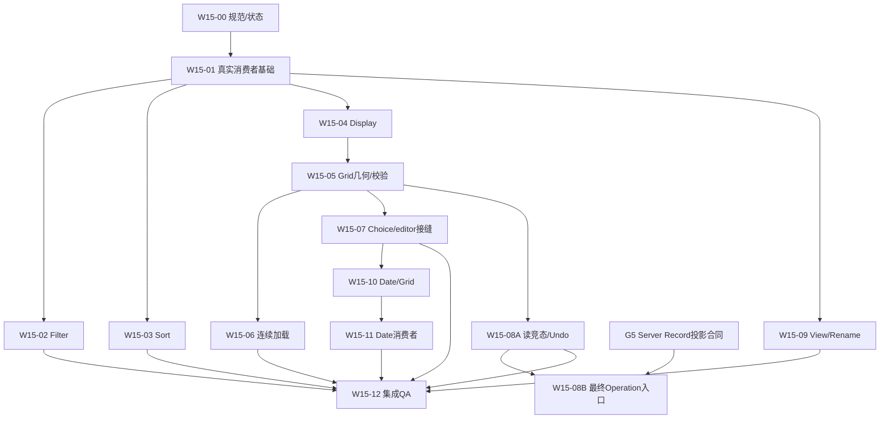

# LoomTable Wave 1.5 — Master Implementation Plan

2026-10-12。设计基线已批准；本文定义后续实施范围和依赖。W15-00已交付，01/02已有实现。本轮以52b2c9d的Figma/真实宿主证据调整工程顺序，历史源码表保留为最初规划基线。审批及实施状态只在 [status.md](status.md) 维护。

## 1. 结论与审批边界

**Wave 1.5 Design Phase Complete — Ready for Engineering Planning / Implementation。** 当前合同支持的组件不需要再开视觉设计轮。剩余问题主要是代码接入、规范同步、运行验证，以及明确隔离的 API/Future 能力。

批准的是现有权威视觉、布局、组件和交互基线，不是将 Registry 中所有 Future/Deferred 示例立刻变成生产功能。Wave 1 继续 Approved/Frozen；普通 chrome 保留宿主可访问 focus-visible，不重新建立 Loom Focus variants。Query-wide selection、Atomic Choice、View tail/CAS、12 色、Table-only Audit/完整 Table 回滚、默认 30d 方向已有产品决定，但其新增 API、存储、兼容性与发布合同仍需按 Gate 评审。不能重复要求用户重选已确定的方向。

视觉量值以 [Design System](../ui/design-system.md) 为唯一规范，交互以 [HIG](../ui/interaction-hig.md) 为准。Clock 指针采用当前批准的统一活动环几何；Future 门槛不随视觉批准改变。

## 2. 当前代码与证据基线

| 项目       | 实际审计结果                                                                                                                                                    |
| ---------- | --------------------------------------------------------------------------------------------------------------------------------------------------------------- |
| Plugin     | `main`，HEAD `336db8c47a5bf52a63eb1a4a127002c43872cf1e`，源码审查开始时 tracked working tree 干净                                                               |
| Server     | `main`，HEAD `5f4827f6b7a7f189aac13e3bc3c0e92377a7873e`，源码审查开始时 tracked working tree 干净；Server 代码只读                                              |
| API pin    | Plugin `openapi/source.json` 在审查基线固定 `43da70e3c241380fff34d0deee8c1142ba39cb47`；Server HEAD 更晚不意味着需要 sync                                       |
| 技术栈     | Native DOM + TypeScript + Obsidian API；现有 `--loom-*`/CSS namespace、Client/Controller/Durable Queue。已有 Leaflet 保持；不新增 runtime dependency/React/框架 |
| 工具与测试 | package Node≥24、pnpm 11.16.0；Vitest/jsdom，真实生产 DOM Gallery；现有测试被阅读，文档整理阶段未运行产品测试/build/codegen                                     |
| 工作区入口 | Plugin 独立克隆直接读本目录 README、status 和 devin-plugin；Server 独立读其 docs/wave1.5/README，不要求同级仓库或本地研究                                       |
| Figma      | 文件 `91zxIAkX7C0MtLD4tJsE8H`；77 canonical 入口=69 sets+8 private glyphs；678 variant masters。三物理页 Foundations/Primitives/Products，Review 只消费实例     |

以上 SHA 是源码审查基线；实施前按真实 HEAD、符号和测试重新定位。Figma 是批准的静态视觉基线，不能作为 Pointer/Wheel、保存、异步或设备验收证据。当前文档整理只验证文档，不声称产品测试通过。

## 3. 完整范围与当前可实施性

77 个入口是设计资产数量，**不是 77 个代码模块或任务**。逐入口处置及完整需求追踪在 [Traceability](traceability.md)。

| 家族                        | 当前实施目标                                                                                                                                                  | Gate / 边界                                                                                                               |
| --------------------------- | ------------------------------------------------------------------------------------------------------------------------------------------------------------- | ------------------------------------------------------------------------------------------------------------------------- |
| Foundations / Primitives    | Host token alias、button appearance、Check optical size、selected menu roles、owned overlay/theme bridge；直接验证现有消费者                                  | 不重做 Frozen masters，不整体换 token 名或建立框架                                                                        |
| Query Panels                | Filter tree/同父 reorder/远端值 owner；Sort 临时 Add picker；Display More/Pin/density/hidden width 保留                                                       | 已有 Query/debounce/View CAS；不新增 Apply，不复制 Record commit，不新增 Filter option create                             |
| Choice / Field Type         | 已有 option ID 选择/搜索/清空；一行 Tags/+N；真实 Field create/edit/type picker、option order及失败恢复                                                       | 12 色 writer、inline Atomic create-and-select 等待 G1/G2；类型转换新业务 Deferred                                         |
| View / Navigation           | text-only Context、ViewTab B、Current/Default 分离、zero-shift Rename、失败/晚响应守卫                                                                        | View reorder、跨端 create/duplicate/restore tail/CAS 等待 G3；不新建 View 回收站                                          |
| Grid / Aggregate            | 88px desktop system track；coarse 132px coherent track；独立命中/handle drag、统一 frozen/rail、Footer 固定36、Current/hover/selection正交、validation bubble | Query-wide Header checkbox 等待 G4；Search作用域聚合等待G6。不谎称 loaded IDs 为全 query，不新增 bulk mutation/二维剪贴板 |
| Continuous loading          | 复用 cursor/100页、keyed DOM/rAF，增量加载与重试，保留原 rows/Current/scroll                                                                                  | 无 API 改造；不是把整个 Table 一次拉满                                                                                    |
| Operation / Deleted         | 当前 read-context/Undo race修复；完整两入口、无 Actor、typed event rows、Deleted真实 restore                                                                  | W15-08B 完整 Ops 投产等待 G5；当前 local Undo 不能冒充 Server feed；Table 回滚 Future                                     |
| DatePicker                  | Gregorian date-only、Day/Month/Year、preferred day、单 commit owner，Grid/Detail/Map/Create Draft                                                             | 当前 Date string/null + set/unset 足够；无 Required Field config，不新增 Date endpoint                                    |
| Time / DateTime             | 已批准视觉和运行合同保留，独立 Future 路线                                                                                                                    | 字段/序列化/时区/精度/config/兼容性需未来批准；12h 最近1–2主要版本仍不实施                                                |
| Cascader / Avatar / Profile | 不安排当前消费者或业务实现                                                                                                                                    | Deferred/Future，不列近期实施任务，不阻断当前 UI                                                                          |

## 4. 阶段组织建议

使用 **Wave 1.5 实施批次**跟踪目录 `docs/wave1.5/`，保持 P1.5/P1.6 的历史定位。它是交付批次，不是未经批准的新产品阶段。

- **Lane A — P1.6-compatible UI convergence**：已有功能替换、交互修复、可访问性/响应式、组件同源 Gallery、技术债。Date 是既有 Date 编辑的替换；Choice/Search/Field/Query/Deleted 等也是已有功能改造。
- **Lane B — contract evolution，逐Gate推进**：G1–G6 的跨层合同及之后的 Time/Table rollback。Gate 获批、隔离 Server 环境就绪和 rollout 方案审查后才能进入，不能塞入 P1.6。G6是已有功能正确性补齐，可经独立批准作为窄API修复例外，不必等待整个P2.0，用户已在Server工作线授权G1–G6工程；实际G1/G6交付与Plugin尚未接入分别见status。本轮不修改Plugin API。
- `docs/p1.6/README.md` 保留阶段范围和旧交接，只维护阶段范围与新批次导航。`docs/wave1.5/status.md` 为本批任务的唯一状态表，阶段 README、AGENTS、Skill 使用引用，不维护第二份进度。P1.5 需求/status保持封存。

Lane A 退出：所有可用合同的已批准需求有代码与测试追踪；真实宿主关键路径通过；API 文件未意外变化；未提供能力有明确 unavailable/gated 表述；Gates 不被标为已交付。Lane B 退出按各合同及 rollout 另行定义。文档准备不启动生产开发；用户授权后的切片逐项启动，不自动批准任何 Server 变更。

## 5. 任务总表：13 个实施包

含 1 个规范基线任务、11 个产品/工程切片、1 个集成验收；不是 13 个同时启动的 Session。W15-08 分当前安全修复 A 与 API-dependent 投产 B；只有 A 可在当前合同下先合并。W15-05的几何/普通Filter聚合可先交付，完整Search汇总等待G6。另列 **6 条 API Gate 轨道**，不混入这 13 个任务包。

| ID        | 可见结果 / 边界                                                                   | 前置                                      | 当前合同支持                                                  |
| --------- | --------------------------------------------------------------------------------- | ----------------------------------------- | ------------------------------------------------------------- |
| W15-00    | 审查并发布已准备的文档基线、唯一状态及 clean-clone 输入                           | 当前文档 diff 审查                        | 是，文档已准备；不重复迁移                                    |
| W15-01    | Primitive 在真实 Menu/Field/Toolbar 消费者中对齐，主题与 owner 正确，失败保 draft | 00                                        | 是                                                            |
| W15-02    | Filter + distinct values：同父 reorder，owner/cursor/失效选择保护                 | 01、07 的 Choice core可复用但不硬等消费者 | 是                                                            |
| W15-03    | Sort 临时 AddField、完整 Entry reorder、失败保 draft                              | 01                                        | 是                                                            |
| W15-04    | Display/Pin/More/density、隐藏宽度保留、resize不被旧 draft覆盖                    | 01                                        | 是                                                            |
| W15-05    | Grid system track/RowHeader/Footer/frozen/rail、正交状态与固定行高校验            | 01、04                                    | 几何/现有Filter汇总是；全query Header等待G4、Search汇总等待G6 |
| W15-06    | 连续分页、独立 incremental loading/error，Current/scroll/editor不跳               | 05                                        | 是                                                            |
| W15-07    | Choice existing-ID/Tags/FieldType/option order，统一窄 editor handle              | 01、05                                    | 是；12色/atomic分流G1/G2                                      |
| W15-08A/B | A 当前 history/recycle读竞态与Undo安全；B最终Operation/Deleted两入口              | 01、05；B额外G5                           | A是；B须Gate，不用local list伪装                              |
| W15-09    | ViewSwitcher、text-only context、zero-shift/context-safe rename                   | 01                                        | 是；order/tail/CAS分流G3                                      |
| W15-10    | Date Calendar + Gregorian parity + 单 owner + 真实 persisted Grid 编辑            | 00、01、05、07的窄handle约定              | 是，无 Server 改造                                            |
| W15-11    | Date Detail/Map/Create Draft 同源接入与释放，无change/blur旁路                    | 10                                        | 是；Query日期保独立合同                                       |
| W15-12    | 集成回归、生产 Gallery、Desktop/可用Mobile验收及阶段收敛                          | 所有 Lane A 已实施包                      | 是；记录Gate/设备限制                                         |

逐包的18项输入、真实模块、测试、失败/回滚及DoD见 [Task Specifications](task-specifications.md)。

## 6. 依赖 DAG 与推荐合并次序

这是实际依赖，不要求等 G5 才完成 Lane A 的验收。O8B 未解锁时 QA 报告其明确 gate，不能标完整 Ops delivered。W15-02 的 Filter option外观可以共享 W15-07 的 Choice list部分；Query operand模型不依赖 Record editor或Atomic API，避免循环依赖。

推荐合并顺序：**00 → 01 → 04 → 05 → 07 → 10 → 11** 先形成 Date 主路径；02/03/09可在各自文件所有权下推进；06和08A随后在Grid/Controller稳定时串行集成；12收敛。这避免“全部基础重构完后才出现消费者”。Date纯逻辑 `date-only.ts` 可与已锁定的Grid样式工作并行，消费者适配合并必须串行。

| 共享热点                                     | 所有权与冲突策略                                                                                          |
| -------------------------------------------- | --------------------------------------------------------------------------------------------------------- |
| `readonly-grid-renderer.ts`、其巨型测试      | 04/05/06/07/08/10/11涉及；一次一个集成 owner。其他 Session 先完成独立模块与测试，再基于最新 main 做窄适配 |
| `grid-view-controller.ts`                    | Display、paging、activity、所有Gate共享；复用 View CAS/Queue。不能不同 Session 各建 coordinator           |
| `field-renderer-registry.ts` + Detail/Create | 07先确定最小 handle，10复用；保留 native createEditor。类型改动一次审查，禁止两份 Date/Choice协议         |
| `styles.css`、icons、i18n、Gallery scenarios | 01先落语义基线；后续限定 consumer 区块，一个集成人review cascade/翻译键/fixtures；不整文件format          |
| Server/OpenAPI/generated/queue schema        | 只有对应 Gate owner 在未来获批后写；UI Session 无权同步/API升级                                           |
| 新模块                                       | Filter/Sort/View重构可按fileowner并行；新增文件没有消费者的空壳不单独合并                                 |

## 7. Date 最小架构与状态边界

技术所有权的唯一来源是 [Field Editor Lifecycle](../architecture/field-editor-lifecycle.md)；交互的唯一来源是 [HIG DatePicker](../ui/interaction-hig.md#datepicker)。采用纯 date-only 逻辑、Date-local 状态和一个经真实消费者验证的窄 product editor handle。保存仍通过现有 Controller/Queue；Create Draft 接受只修改本地值。W15-10/11 的任务卡给出具体 adapter、异步取消、失败与资源释放验收。

## 8. API/Future 门槛

六条 Gate 和 Future 的精确边界、启用条件及跨版本验收统一见 [API Boundary](api-boundary.md)。Plugin 可以先交付当前合同支持的 UI；受影响部分等待 **批准的领域/OpenAPI 合同 → Server 实现与隔离验证 → 固定 Server commit → Plugin generated/client/queue → 真实 UI 接入**。

G1 12 色写入、G2 Atomic Choice、G3 View order、G4 Query RowSelection、G5 Table Audit/Record projection、G6 Aggregate Search 分开审批与交付；G6 可以单独实施正确性补齐。Time/DateTime 与整 Table 回滚另列 Future。当前 Date 和既有 Query/Display/Record 生命周期不要求 Server 改造。运行时动效按 HIG 实现与测试，不安排 Figma Motion、工具扩展或升级任务。

## 9. 验收与安全测试环境

| 层                   | 可以证明                                                                               | 不能替代                           |
| -------------------- | -------------------------------------------------------------------------------------- | ---------------------------------- |
| Unit/DOM             | Gregorian、状态、事件/重入、aria、请求次数、取消/失败/context、宽度map/Undo队列模型    | 像素、Touch物理、Electron焦点/clip |
| Integration/InMemory | 生产Controller/Queue/UI的真实调用、typederrors/CAS/unknown的fixture路径                | 真实Server事务或设备行为           |
| Gallery browser      | 同生产factory真实CSS/布局/theme、hit区/scroll/hosttoken fallback、longtext/窄pane      | 完整ObsidianCSS环境/移动WebView    |
| API contract         | 当前Date/set-null/unset/CAS/receipt；未来Gate schema+兼容                              | 没有部署环境时不能声称e2e通过      |
| Obsidian Desktop/CDP | 实际Pane/Popover、keyboard/IME/focus/pointer/wheel、theme、reducedmotion、cleanup/perf | 真实Mobile touch/OS accessibility  |
| 实际Mobile           | coarse布局、touchscroll/drag、keyboard遮挡/safearea、WebViewsnap                       | 桌面pointer仿真不作为Mobile通过    |
| Figma静态            | 批准视觉/尺寸/状态参考                                                                 | 任何RuntimeQA或保存语义验收        |

每个源码切片先聚焦测试，再`pnpm format:check`、`pnpm lint`、`pnpm typecheck`、`pnpm test:run`、`pnpm check`/build，按package实际scripts与workflow执行；`api:check`会生成transport，未来执行应确认diff为零，文档整理阶段不运行该生成命令。Docs-only W15-00仅format/link/traceability/diff审查；开发测试基线在首次代码切片记录，不沿用历史测试数量作为本次通过证据。

Server集成测试需要独立合成数据环境。`internal/storage/postgres/integration_test.go`在指定test数据库执行`DROP SCHEMA public CASCADE`，不能指向生产或长期共享数据库。优先CI/专用可销毁testDB；不默认本机Docker/PostgreSQL，不重置远端生产数据。当前UI任务用InMemory/typedfakes覆盖竞态；需要真实API时注明环境、权限和数据owner，未具备就明确未测。

QA出口按实际已解锁范围：每条Requirement→Task→Test→宿主结果可追踪；未测试Mobile标未验证，不以Figma截图/TS编译冒充完成。性能沿现有boundedDOM/keyed/rAF预算，运行测量记录实际基线与回归，不编造FPS承诺。释放listener/timer/rAF/observer/capture、无latepublish、无资源累积是必须项。

## 10. 执行入口与维护

正式文档已按 [README](README.md) 的职责分工准备。W15-00 审查链接、规范冲突、完整覆盖和纯文档 diff，并按授权发布文档基线；不再从本地研究重新提炼。然后 W15-01 建立第一个真实 Primitive 消费者纵向切片。

Plugin 执行见 [Devin Guide](devin-plugin.md)，Server 执行见 [Server 独立入口](https://github.com/Mahjong404/LoomTable-Server/blob/main/docs/wave1.5/README.md)。重大合同和风险见 [Risk Register](risk-register.md)。每个 PR 同步 [status](status.md) 和 [traceability](traceability.md)；尚未解锁部分保持 Gated，不自动发布、合并或启用未来业务能力。

## UI 工程重校准的执行顺序

用户2026-10-12调整实施方法：功能测试、code review与历史Host PASS不能代表Figma视觉落地。先按 [ui-alignment](ui-alignment.md) 的真实证据，补同一DS/HIG/Grid/Lifecycle及任务合同；不重开设计阶段。

第一批串行：W15-01共享正确性→W15-01真实Primitive/Showcase→W15-05几何与W15-09 Shell/Tab外观子集，交付一个完整Grid产品页面。使用当前合法Display config，不要求先完成04的所有UI；之后04仍负责hidden-width/freeze/resize intent合同，05剩余依赖保留。A/B/C定义和首批Prompt只在task-specifications维护。

页面通过功能、Figma量尺及实际Host三门后，第二批才做02视觉续段→03→04，收拢05剩余/06；随后07→10→11、08A与09剩余按热点owner串行，08B依赖G5。G1/G6 Plugin接入另按API Boundary用已交付固定SHA，不让API进度驱动未验收UI扩散；Future不进入。

每段交付真实consumer、同源Showcase与宿主证据。不能只写组件库/Gallery，也不能只围绕旧DOM加补丁；组件抽取限制在两个真实消费者验证的control/owned-overlay接缝，领域draft/值/提交协议继续各自owner。
